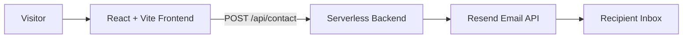

# Gisela Spina | QA Automation Portfolio

[Versión en español](README.md) · [Live Portfolio](https://filotropo-dentronf.vercel.app) · [GitHub](https://github.com/Gisela84spina)

[](https://github.com/Gisela84spina/Gisela_Spina_Portfolio/actions/workflows/main.yml)

## Overview

Personal portfolio developed with React and Vite, featuring a contact form connected to a custom serverless backend.

This repository also demonstrates my practical work in **QA Automation**, including end-to-end testing with Playwright and continuous integration with GitHub Actions.

The project combines frontend development, automated quality checks, test design, and CI pipeline configuration in a real application.

**Live website:** [filotropo-dentronf.vercel.app](https://filotropo-dentronf.vercel.app)

## Key Features

- Responsive navigation with a mobile-friendly menu.
- Project showcase with carousel navigation and direct links.
- Downloadable CV in PDF format.
- Contact form integrated with a custom backend.
- Automated end-to-end tests covering key user journeys.
- Continuous integration pipeline validating code quality, tests, and production builds.

## Technology Stack

| Area | Technologies |
|---|---|
| Frontend | React 18, Vite 6, Tailwind CSS 3 |
| UI and animations | Framer Motion, react-slick, Lucide React |
| Backend | Node.js, serverless function |
| Email delivery | Resend |
| Test automation | Playwright, TypeScript |
| Test architecture | Page Object Model (POM) |
| Code quality | ESLint 9 |
| CI/CD | GitHub Actions |
| Deployment | Vercel |

## Application Architecture



The contact form sends the visitor's name, email address, and message to a dedicated backend endpoint:

`https://backend-contacto.vercel.app/api/contact`

The backend (`backend/api/contact.js`) validates required fields, email format, and maximum input length. It also restricts permitted origins through CORS and uses Resend to deliver messages.

Sensitive credentials are managed through environment variables and are not hardcoded in the source code.

| Environment variable | Purpose |
|---|---|
| `RESEND_API_KEY` | Resend API authentication |
| `CONTACT_TO` | Recipient email address |

The `.env` file is excluded through `.gitignore` and is not committed to the repository.

The frontend and automated tests do not require environment variables.

## End-to-End Testing Strategy

The automated test suite uses Playwright with TypeScript to validate the main user journeys through a real browser.

**Test execution configuration**

| Configuration | Details |
|---|---|
| Browser | Firefox |
| Desktop project | `desktop-firefox` |
| Mobile project | `mobile-firefox` |
| Mobile viewport | 375 × 667 |
| Test files | 2 |
| Test cases | 8 |
| Total executions | 16 |
| Parallel workers | 2 in CI |

The mobile project uses a mobile-sized viewport to validate responsive behavior. It does not emulate a physical mobile device, touch input, or a mobile user agent.

### Covered Scenarios

| Test file | Scenario | Validation |
|---|---|---|
| `portfolio.spec.ts` | Portfolio loading | Page availability, non-empty title, and visible heading. |
| `portfolio.spec.ts` | Contact navigation | Navigation to the contact section, including the mobile menu. |
| `portfolio.spec.ts` | Project links | Presence of links to three portfolio projects. Destination availability is not tested. |
| `portfolio.spec.ts` | CV download | Download event, filename, and PDF extension. |
| `contact-form.spec.ts` | Form visibility | Form heading, input fields, and submit button. |
| `contact-form.spec.ts` | Successful submission | Loading state and success feedback after a simulated HTTP 200 response. |
| `contact-form.spec.ts` | Server error | Error feedback after a simulated HTTP 500 response. |
| `contact-form.spec.ts` | Form validation | Native browser validation for required fields and email format. |

### Test Isolation and Reliability

The contact form tests intercept backend requests using Playwright's `page.route`.

This approach provides predictable test execution, avoids sending real emails, and removes dependency on the availability of the external backend.

Playwright starts the Vite development server automatically through the `webServer` configuration.

When a test fails, the configuration retains its trace for diagnostic purposes and generates an HTML report.

## Page Object Model

The test suite applies the Page Object Model to centralize page-specific locators and navigation behavior.

The Page Objects are located in `test/pages/`:

- **HomePage:** handles the home page, main heading, contact navigation, and navigation to the contact section.
- **ContactPage:** centralizes the contact form locators, including its heading, fields, and submit button.

Accessible role-based locators (`getByRole`) are prioritized where applicable. Form fields are located through their placeholders.

The current implementation centralizes locators and page access. Some multi-step interactions remain within the test specifications.

## Continuous Integration — GitHub Actions

The repository includes a GitHub Actions workflow named **Portfolio - Quality Pipeline**.

Workflow file:

`.github/workflows/main.yml`

It runs automatically on pushes and pull requests targeting `main`.

The workflow uses a single job, `Quality Checks`, on `ubuntu-latest`.

### Pipeline Execution

1. Checkout repository.
2. Set up Node.js 22 with npm dependency caching.
3. Install dependencies using `npm ci`.
4. Run ESLint.
5. Generate the production build.
6. Install Firefox for Playwright.
7. Execute the automated test suite.
8. Upload test reports and traces as workflow artifacts, including when previous steps fail.

### Automated Quality Gates

| Quality gate | Command | Purpose |
|---|---|---|
| Static analysis | `npm run lint` | Detect code quality and linting issues. |
| Production build | `npm run build` | Verify that the application can be compiled for production. |
| End-to-end testing | `npx playwright test` | Validate the main user journeys automatically. |

The workflow uses minimum repository permissions (`contents: read`) and does not require GitHub secrets.

### Latest Verified CI Results

The verified execution completed successfully:

- ESLint: passed.
- Playwright: 16 tests passed.
- Production build: successful.
- Build output: 2,046 modules transformed.

All three quality gates completed successfully in GitHub Actions.

## Reports and Diagnostic Artifacts

The workflow uploads Playwright reports and test traces as artifacts.

To access them:

1. Open the repository's [Actions tab](https://github.com/Gisela84spina/Gisela_Spina_Portfolio/actions).
2. Select a workflow execution.
3. Locate the **Artifacts** section.
4. Download `playwright-report-and-traces`.

Artifacts are retained for 14 days.

To open a downloaded HTML report locally:

```bash
npx playwright show-report playwright-report
```

When a test fails, the corresponding trace can be inspected with:

```bash
npx playwright show-trace <path-to-trace.zip>
```

Traces are retained according to the configured Playwright policy.

## Running the Project Locally

### Prerequisites

- Node.js 22
- npm
- Git

### Installation

```bash
git clone https://github.com/Gisela84spina/Gisela_Spina_Portfolio.git

cd Gisela_Spina_Portfolio

npm ci

npx playwright install firefox
```

### Available Commands

| Command | Description |
|---|---|
| `npm run dev` | Starts the Vite development server. |
| `npm run lint` | Runs ESLint. |
| `npm test` | Executes the Playwright test suite. |
| `npx playwright test` | Executes Playwright tests directly. |
| `npm run build` | Generates the production build. |
| `npm run preview` | Serves the production build locally. |
| `npx playwright show-report` | Opens the latest HTML test report. |

## Technical Decisions

**Mocked backend responses during E2E tests**

The contact form API is intercepted to keep tests deterministic, avoid real email delivery, and isolate frontend behavior from backend availability. Backend business rules are therefore not validated by this test suite.

**Single-browser strategy**

Firefox was selected to keep the initial automated suite focused and maintainable. Chromium and WebKit coverage are not currently included.

**CI execution order**

Static analysis and production compilation run before the slower end-to-end suite. This allows basic issues to be detected earlier in the pipeline.

**Reproducible dependency installation**

`npm ci` is used in CI to install dependencies from the committed lock file, providing consistent installations.

**Failure diagnostics**

Playwright reports and traces are uploaded as artifacts even when earlier workflow steps fail, supporting investigation and troubleshooting.

## Known Limitations and Future Improvements

The following items represent known limitations and opportunities for further development.

### Test Coverage and CI

- E2E tests run against the Vite development server, not a production preview.
- Backend behavior is not covered by automated tests.
- Form validation tests currently focus on native browser validation.
- The pipeline validates the frontend but does not install or test the backend independently.
- Vercel deployment is independent of the CI workflow.
- Automated browser coverage is currently limited to Firefox.
- The mobile project validates responsive layout using a mobile viewport, not a real device.

### Application

- The submit button is not currently disabled while a request is being processed, so repeated clicks may trigger duplicate submissions.
- The backend does not currently implement rate limiting or dedicated spam protection.
- Resend uses its test sender address (`onboarding@resend.dev`) rather than a verified custom domain.
- Server-side rejection messages are presented to the user through a generic error message.

These limitations are documented deliberately to make the current scope and coverage explicit.

## Author

**Gisela Spina**

QA Automation / Developer

- [GitHub](https://github.com/Gisela84spina)
- [LinkedIn](https://www.linkedin.com/in/gisela-spina/)

